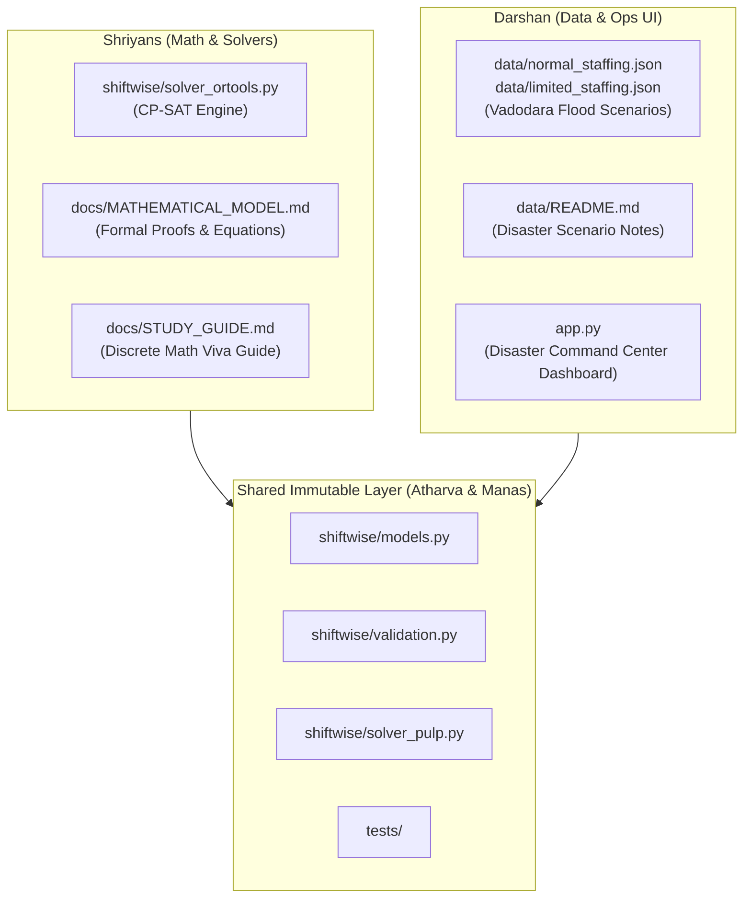

# ReliefOpt: Disaster Relief Resource & Task Allocation
## Implementation Plan & Work Division

**Course:** Program Development Laboratory (PDL) — Discrete Mathematics Project  
**Inspiration:** [DisasterRelief](https://github.com/ShriyansBharuka/DisasterRelief) (Streamlined for academic discrete optimization)  
**Evaluator Target:** Discrete Mathematics Teacher  
**Core Mathematical Pillars:** Combinatorics, Bipartite Graph Matching, Deterministic Constraint Optimization (Google OR-Tools CP-SAT & PuLP)

---

## 1. Scope, Simplification & Architectural Boundaries

### What We Are Building
A high-performance, deterministic **Disaster Resource & Task Allocation System** in pure Python. The system assigns emergency response units (Rescue Boats, ALS Ambulances, NDRF Teams, Drone Convoys, Medical Units) to emergency distress incidents across flooded city sectors.

### What We Intentionally Removed (No Over-Engineering)
Per the Discrete Math teacher's explicit guidance (*"keep it simple and explainable"*):
- ❌ **No WhatsApp Bot / SMS Integration** (replaced by deterministic scenario datasets).
- ❌ **No Multi-Language Translation / External AI APIs** (no Claude/OpenAI API keys, no Gujarati/Hindi parsing).
- ❌ **No Hash-Chained Blockchain / Tamper-Evident Ledgers** (pure in-memory deterministic state).
- ❌ **No MongoDB / External Databases / WebSockets** (lightweight, zero-setup, reproducible Python execution).

### What We Kept & Upgraded
- ✅ **Combinatorial Bipartite Graph Formulation**: Discrete matching between emergency response units $R$ and emergency incidents $I$.
- ✅ **Hard Constraints**: Capability/skill prerequisites, shift exclusivity ($\le 1$), unit operational workload caps, and interval overlap mutual exclusion.
- ✅ **Coverage-First & Life-Saving Triage Hierarchy**: Mathematical objective scaling ensuring Critical (RED) rescues strictly outrank routine (GREEN) supply deliveries.
- ✅ **Dual-Solver Benchmark**: Identical mathematical formulation implemented in both **Google OR-Tools CP-SAT** and **PuLP (Branch-and-Cut ILP)** with side-by-side performance metrics.
- ✅ **Streamlit Operations Command Center**: Visual timeline, triage status badges, resource capacity meters, and CSV dispatch manifest export.

---

## 2. Shared Data Contract

The shared Python contracts in `shiftwise/models.py` link the dataset, UI, and both solvers:

### 1. Resource Unit (`Volunteer` / `ResourceUnit`)
```python
@dataclass(frozen=True)
class ResourceUnit:
    id: str                               # e.g., "NDRF-BOAT-01", "ALS-AMB-02"
    name: str                             # Display name: "NDRF Inflatable Rescue Boat 1"
    skills: frozenset[str]                # Capabilities: {"Boat", "Water_Rescue", "ALS"}
    available_slot_ids: frozenset[str]    # Operational reach / available incident IDs
    max_assignments: int                  # Workload capacity cap (fatigue limit)
    preferred_slot_ids: frozenset[str]    # Base proximity / specialty preference
```

### 2. Emergency Incident (`ShiftSlot` / `EmergencyIncident`)
```python
@dataclass(frozen=True)
class EmergencyIncident:
    id: str                               # e.g., "rescue-water-1", "trauma-hospital-1"
    role: str                             # Emergency title: "Evacuation of Stranded Family"
    start_time: int                       # Integer minutes after midnight (e.g., 540 = 09:00 AM)
    end_time: int                         # Integer minutes after midnight (e.g., 660 = 11:00 AM)
    required_skill: str | None            # e.g., "Boat", "ALS", or None for general tasks
```

### 3. Allocation Result (`SolverResult`)
```python
@dataclass(frozen=True)
class SolverResult:
    status: str                           # "optimal", "feasible", or "no_solution"
    assignments: list[tuple[str, str]]    # list of (resource_id, incident_id)
    filled_slots: int                     # Number of incidents covered
    total_slots: int                      # Total emergency incidents
    preference_count: int                 # Priority / preference matches
    elapsed_seconds: float                # Pure solver execution latency in seconds
```

---

## 3. Two-Person Parallel Execution Plan (Shriyans & Darshan)

To finish the project ASAP, **Shriyans** and **Darshan** will prompt their AI agents simultaneously on isolated components.



---

### Track A: Darshan — Disaster Datasets & Streamlit Ops Dashboard

**Owned Files:**
1. `data/normal_staffing.json` & `data/limited_staffing.json`
2. `data/README.md`
3. `app.py`

**Milestone Tasks:**
- [ ] **Disaster Datasets**:
  - Re-theme the synthetic scenarios to the **Vadodara Flood Emergency**:
    - **Resource Units:** NDRF Rescue Boats, Advanced Life Support (ALS) Ambulances, Fire Brigade Heavy Rescue, Medical Triage Vans, Supply Drone Convoys.
    - **Incidents:** Rooftop Flood Rescue, Cardiac Hospital Transfer, Flooded Old-Age Home Evacuation, Clean Drinking Water Supply, Debris Clearing.
    - **Normal Staffing:** 11 response units covering all 10 critical incidents.
    - **Limited Staffing (Catastrophic Shortage):** Flooded access makes rooftop rescue impossible without specialized boat units; an unavoidable vacancy demonstrates partial coverage.
- [ ] **Streamlit Command Center UI (`app.py`)**:
  - Rebrand as **"ReliefOpt: Disaster Relief Resource & Task Allocation"**.
  - **Top Control Header**: Scenario & solver selection with disaster status badge.
  - **Triage Visual Indicators**:
    - 🔴 **Critical (RED)**: Immediate life hazard (e.g. rising floodwaters, severe trauma).
    - 🟠 **Urgent (YELLOW)**: Serious distress (medical evacuation, vulnerable groups).
    - 🟡 **Routine (GREEN)**: Supply/food convoy, debris clearance.
  - **Interactive Tabs (`st.tabs`)**:
    - *Tab 1: 📅 Dispatch Manifest & Schedule*: Visual shift cards and clear table with status chips (`DISPATCHED` vs. `⚠️ UNATTENDED`).
    - *Tab 2: 👥 Resource Utilization*: Capacity progress bars (`1 / 2 incidents [50%]`).
    - *Tab 3: ⚖️ Solver Comparison*: Side-by-side OR-Tools vs. PuLP benchmark.
    - *Tab 4: 📘 Model & Disaster Scenario Info*: Discrete math explanation.
  - **CSV Export**: Instant download of the field dispatch manifest.

---

### Track B: Shriyans — CP-SAT Solver & Mathematical Model

**Owned Files:**
1. `shiftwise/solver_ortools.py`
2. `docs/MATHEMATICAL_MODEL.md`
3. `docs/STUDY_GUIDE.md`

**Milestone Tasks:**
- [ ] **OR-Tools CP-SAT Solver (`shiftwise/solver_ortools.py`)**:
  - Maintain the frozen `solve(volunteers, slots) -> SolverResult` interface for 100% contract compatibility.
  - Instatiate binary variables $x_{r,i}$ strictly for eligible pairs (matching capability and availability).
  - Enforce exclusivity $\sum x_{r,i} \le 1$, unit workload caps $\sum x_{r,i} \le \text{cap}(r)$, and half-open interval overlap conflicts $x_{r,i_1} + x_{r,i_2} \le 1$.
  - Implement coverage-first objective with preference/triage tie-breaking:
    $$\max \quad (|I| + 1) \sum_{(r,i) \in E} x_{r,i} + \sum_{(r,i) \in P} x_{r,i}$$
  - Return normalized statuses (`optimal`, `feasible`, `no_solution`), sorted assignments, and elapsed seconds.
- [ ] **Mathematical Documentation (`docs/MATHEMATICAL_MODEL.md`)**:
  - Update the formal bipartite graph formulation for emergency disaster dispatch.
  - Include the mathematical proof of coverage dominance.
  - Provide complete mathematical traces of the Vadodara Flood scenario.
- [ ] **Study & Viva Guide (`docs/STUDY_GUIDE.md`)**:
  - Comprehensive discrete math study guide and viva questions for all 4 team members.

---

## 4. Immediate Verification & Acceptance Criteria

1. **Test Suite:** `python -m pytest -p no:faker` must pass all unit and contract tests with 0 errors.
2. **Deterministic Solves:** Both OR-Tools and PuLP must reach the exact same optimal coverage and preference/triage score on both scenarios.
3. **No External Network / DB Dependencies:** The entire application must launch cleanly with `python -m streamlit run app.py` without requiring API keys, Twilio credentials, or a MongoDB server.
4. **Explainability:** Any team member must be able to point to any decision variable $x_{r,i}$ and explain its constraints and objective coefficient to the Discrete Mathematics teacher.
